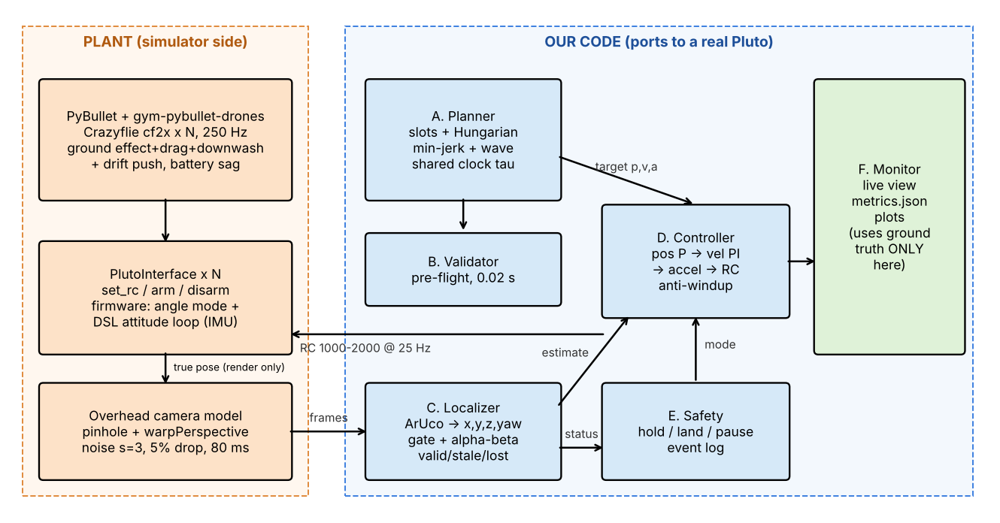
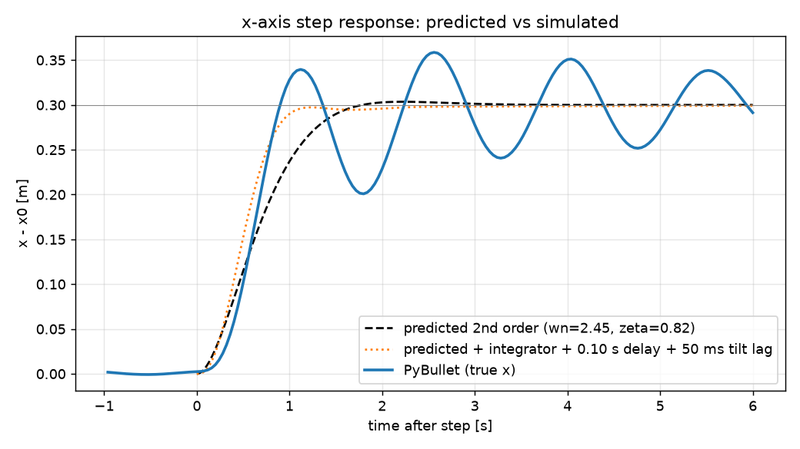

# SwarmSim-Lite — Drona Mock PS Report
**Vishesh Singh · 2502MT08** · Simulator: PyBullet / gym-pybullet-drones (cf2x, `PYB_GND_DRAG_DW`), 250 Hz physics, 25 Hz control · ROS 2: not attempted · External repo: `utiasDSL/gym-pybullet-drones` (physics + attitude part of `DSLPIDControl` inside `PlutoInterface`).

## 1. Architecture

**Information flow.**

- The controller sees **only** camera estimates.
- Ground truth is used only to render the camera image and to compute metrics.
- Our code reaches a drone only through `PlutoInterface.set_rc / arm / disarm`, so the same code ports to a real Pluto by swapping that one class.

## 2. Metrics (auto-generated, `logs/*/metrics.json`)
| Run | Track RMS (cm) ≤10 | Shape RMS (cm) | Phase sync (°) ≤10 | Min sep (m) ≥0.35 | Loc RMS (cm) | x/y/z loc (mm) |
|---|---|---|---|---|---|---|
| circle_N4 | 2.4 | 2.2 | 0.5 | 0.522 | 2.2 | 4/4/21 |
| line_N4 | 2.3 | 2.1 | 2.6 | 0.384 | 2.3 | 7/2/21 |
| line_N4_F1 | 2.3 | 2.1 | 3.2 | 0.384 | 2.3 | 8/2/22 |
| line_N4_F3 | 2.2 | 2.1 | 2.6 | 0.384 | 2.3 | 7/2/22 |

Events (line_N4_F1): see `logs/line_N4_F1/events.csv`. Events (line_N4_F3): see `logs/line_N4_F3/events.csv`.

## 3. Math
**M1. Quadrotor dynamics.**

URDF (`cf2x.urdf`, values printed in `model_info.json`):

| Parameter | Value |
|---|---|
| Mass m | 0.027 kg |
| Arm L | 0.0397 m |
| k_f | 3.16·10⁻¹⁰ N/rpm² |
| k_m | 7.94·10⁻¹² N·m/rpm² |
| Thrust-to-weight | 2.25 |
| J | diag(1.4, 1.4, 2.17)·10⁻⁵ kg·m² |

Equations of motion:

- Translation: m p̈ = R(T e_z) − m g e_z + f_ext
- Rotation: J ω̇ = τ − ω × Jω
- Rotor thrust and torque: T = Σ k_f Ω_i², τ_z = Σ ±k_m Ω_i²

Thrust limits and hover point:

- T_max = 2.25 m g = 0.596 N, so hover RPM = √(mg/4k_f) ≈ 14 480 (max ≈ 21 710).
- Throttle maps 1000 → 0 and 2000 → T_max, so **hover throttle = 1000 + 1000·mg/T_max = 1444**, not 1500.
- At 93 % battery it rises to 1000 + 444/0.93 = **1478**.

**Why underactuated:** there are 4 independent inputs (T, τ_x, τ_y, τ_z) for 6 degrees of freedom. The thrust always acts along body z, so x and y can only be reached *through* attitude (tilt first, then accelerate). The flat outputs are (x, y, z, ψ).

**M2. Wave kinematics.**

- Position: z_i = 1 + A sin(ωt − φ_i), with A = 0.2 m and ω = 2π/6 = 1.047 rad/s.
- Velocity: ż = Aω cos(·), peak **0.209 m/s**.
- Acceleration: z̈ = −Aω² sin(·), peak **0.219 m/s²**.
- The start and end use a C² amplitude envelope e(t) (min-jerk over 1.5 s), so z, ż and z̈ are continuous.

Thrust-limited maximum ω at 93 % battery:

- Upward headroom: (0.93·2.25 − 1)g = 10.7 m/s², so ω ≤ √(10.7/0.2) = 7.3 rad/s.
- Downward: at most g, so ω ≤ √(9.81/0.2) = 7.0 rad/s. With the DSL idle-PWM floor it is about 5.3 rad/s.
- **ω_max ≈ 5–7 rad/s (period ≈ 1 s).**

The practical limit is delay τ ≈ 0.12 s (camera + control):

- An uncompensated loop lags by ωτ. Requiring ωτ ≤ 10° gives ω ≤ 1.45 rad/s.
- We remove this with acceleration/velocity feed-forward and latency extrapolation.
- A *common* delay does not affect inter-drone sync.

**M3. Separation.**

For drones i and j with horizontal offset Δh:

d_ij(t)² = Δh² + [2A sin(Δφ/2) cos(ωt − φ̄)]²

The second term reaches 0 every half-cycle, so **d_min = Δh**:

- Line: d_min = d.
- Circle: d_min = 2R sin(π/N).

**Line limits:** need d ≥ 0.35 and (N − 1)d ≤ 2.0, so **N_max = 6**.

**Circle limits:**

- Need R ≥ 0.175/sin(π/N).
- The fence requires R·max|sin θ_i| ≤ 0.6 and R ≤ 1.
- So **N_max = 10**, with R ∈ [0.566, 0.631] for N = 10.

**Is N = 10 possible?**

- Line: no.
- Circle: geometrically yes, but with ≤ 2 cm margin against a 10 cm tracking target, and straight transits from the ground grid collide (validator: 0.26–0.30 m). So it is not safely flyable without layered or sequential transits.

**Transit safety.** We assign slots by minimising Σ‖a_i − b_i‖² (Hungarian algorithm).

- Swap-optimality gives u·v ≥ 0, where u = a_i − a_j and v = b_i − b_j.
- On synchronised straight-line paths, d(s)² = (1−s)²|u|² + s²|v|² + 2s(1−s)u·v ≥ |u|²|v|²/(|u|² + |v|²).
- So d ≥ D/√2. Spawn and slot spacing 0.55 m therefore gives d ≥ 0.389 m > 0.35 m.

**M4. Camera geometry.**

The camera sits at height H = 3 m. Depth is Z = H − z, and the pixel coordinates are:

u = f_x x/Z + c_x, v = −f_y y/Z + c_y

Inverse mapping: x = (u − c_x)Z/f_x and y = −(v − c_y)Z/f_y. Depth comes from marker size: Z = f_x s/ℓ_px.

Field of view:

| Drone height z | Field of view | Notes |
|---|---|---|
| 0.6 m | ±1.71 × ±0.96 m | |
| 1.4 m | ±1.14 × ±0.64 m | Arena y = ±0.6 barely fits |

Cost of a 1-pixel error:

| Height | δx, δy = Z/f | δZ = Z²/(f s) per px of marker size |
|---|---|---|
| z = 0.6 m | 2.7 mm | **8.0 cm** |
| z = 1.4 m | 1.8 mm | **3.6 cm** |

**z is the worst axis.** x and y come from the marker centre, but depth is visible only through the marker's apparent size (25–45 px). Sensitivity grows with Z², about Z/s ≈ 20–30× worse than x and y.

Measured (`tools/calibrate_vision.py`) std is 3–4 mm in x/y and 9–15 mm in z. We use a level-marker model rather than 6-DoF PnP, because PnP's tilt is ill-conditioned for a ~36 px marker and was 2–3× worse.

**M5. Control design.**

Linearised about hover with small angles:

- ẍ = gθ, ÿ = −gφ, δz̈ = δT/m.
- RC gains: 5.14·10⁻³ m/s² per roll/pitch unit; 0.0221 m/s² per throttle unit (k_thr = 45.3 throttle per m/s²).

Per axis, the cascade is v_cmd = K_p e_p + v_ff and a = K_v(v_cmd − v) + K_i∫e_v + a_ff, which gives ẍ + K_v ẋ + K_vK_p x = K_vK_p x_ref:

- ω_n = √(K_vK_p)
- ζ = ½√(K_v/K_p)

Chosen gains:

- xy: K_p = 1.5, K_v = 4, so ω_n = 2.45 rad/s, ζ = 0.82, predicted overshoot 1.2 %.
- z: the same (K_p = 1.5, K_v = 4). We tried K_p = 2, K_v = 5 first, but z is the noisiest axis (M4) and the stiffer loop amplified vision noise into ~5 cm error; the softer loop halved it.

Design rules:

- K_v ≤ ~4–5 keeps ≥ 45° phase margin with about 0.13 s of total delay.
- K_v/K_p ≥ 2.5 separates the two loops.
- K_i is a slow zero (K_i/K_v = 0.25 rad/s) that only kills constant drift and learns hover and sag.

Predicted vs simulated x-step (0.3 m): see figure; numbers printed by `step_test.py`.

## 4. Methodology (not coded)
**1. Kalman filter with latency.**

State per axis: x = [p, v, d]ᵀ, where d is a constant disturbance (drift, hover error). The input u is the commanded acceleration.

- F = [[1, Δt, ½Δt²], [0, 1, Δt], [0, 0, 1]], B = [½Δt², Δt, 0]ᵀ, H = [1 0 0].
- Q = σ_a²·GGᵀ (white acceleration, G = [½Δt², Δt, 0]ᵀ, σ_a ≈ 0.5 m/s²) + diag(0, 0, q_d) (slow random walk of d).
- R = σ² from calibration: (4 mm)² for x/y and (15 mm·(Z/2.2)²)² for z (grows with Z²).

Handling the **80 ms camera delay:**

1. Keep a 0.3 s ring buffer of (x̂, P, u).
2. When a frame stamped t_c arrives, rewind to t_c and do the update there.
3. Re-propagate the stored inputs forward to now.

Handling the **40 ms command delay:** before computing the control, predict 40 ms further ahead using the commands already sent (Smith-predictor idea).

The estimated d also becomes a feed-forward term, so the integrator has less work.

**2. Yaw drift 0.5 °/s.**

Roll/pitch commands act in the body frame. If heading is wrong by δ, the actual acceleration is a = R_z(δ) a_cmd.

- Cross-coupling grows as sin δ: 30° after 60 s.
- Loop gain falls as cos δ; for δ > 90° it is positive feedback, and the drone spirals away.
- **Fix:** take yaw from vision (marker edges), compute a_body = R_z(−ψ_vision) a_world, and hold yaw with ψ_vision (already implemented in `controller.acc_to_rc`). The firmware's drifting yaw never enters our maths.

**3. Downwash.**

Data collection: hover drone A, then place drone B below it on a grid of (r, Δz) points. B's z-integrator (`Iz` in telemetry) directly reads the extra thrust it needs.

Fit the gym-pybullet-drones form: F_dw = −α(Δz) exp(−½(r/β(Δz))²), with α = k₁(r_p/4Δz)² and β = k₂Δz + k₃.

The cone radius is r_dw(Δz) = β·√(2 ln(α/F_tol)), with F_tol ≈ 5 % of mg.

Validator rule: for every sample and every pair with z_j < z_i, require r_ij > r_dw(z_i − z_j); otherwise reject with "drone j in downwash of i at t".

**4. Thrust and tilt limits.**

For each plan sample, compute the required force f = m(a_plan + a_margin + g e_z), where a_margin covers drift (0.15√3) plus controller authority. The plan is flyable only if all three hold:

- ‖f‖ ≤ η·0.93·T_max (η ≈ 0.7)
- tilt = acos(f_z/‖f‖) ≤ 15°
- f_z ≥ T_idle

A simplified version (50 % margins) is already in `validator.py`.

**5. Fault drills.**

**F2 — drone 3's marker hidden 1.2 s:**

1. At 150 ms the drone goes stale: it flies level on its learned trims (I_xy cancels drift, I_z holds hover) and the swarm clock pauses.
2. At 300 ms it is lost: blind descent (−0.3 m/s² for 1 s, then constant 0.3 m/s).
3. When the marker returns, it continues with a vision-guided landing at its current x, y.
4. The swarm resumes once it is disarmed.

Residual drift during the gap is ½·Δa·t², which is under 2 cm with learned trims.

**F4 — drone 0 gets no commands for 1 s:** its firmware failsafe levels it and descends. Vision-only detection:

- Run a residual test: r = a_measured (Kalman filter) − a_predicted from the RC we sent.
- If r²/σ² exceeds a χ² threshold for 0.3 s, mark the drone UNRESPONSIVE (the signature is a level descent that ignores throttle).

Reaction:

1. The swarm pauses.
2. Drone 0 is treated as a moving obstacle with an inflated separation radius along its predicted descent.
3. Neighbours whose predicted distance drops below 0.35 m + margin hold or land.
4. If drone 0 responds again, it is landed rather than re-admitted.

**6. Sim-rendered camera.**

- `p.computeViewMatrix(eye=[0,0,3], target=[0,0,0], up=[0,1,0])`
- `p.computeProjectionMatrixFOV(fov=2·atan(360/900)=43.6°, aspect=16/9, near=0.1, far=5)`, which reproduces f = 900.
- `p.getCameraImage(1280, 720)`

Each drone gets a thin marker link with `p.loadTexture(aruco_i.png)` applied via `changeVisualShape`. Then:

- Check the intrinsics with a calibration board.
- Keep the same Localizer.
- Add noise, drops and latency after rendering.

(MuJoCo equivalent: `<camera fovy>` plus `<texture>`/`<material>` on a marker geom.)

**7. Scaling 4 → 10.**

**What breaks first is the arena.**

- A line is impossible for N > 6.
- A circle needs R ∈ [0.566, 0.631], with no tracking margin.
- Transits need altitude layers or sequencing.

Next are comms: 10 Wi-Fi/MSP links at 25 Hz on one channel bring jitter and packet loss. Fixes: router/station mode and staggered send slots.

Compute last. Complexity per tick:

| Component | Cost |
|---|---|
| Localisation | O(pixels) + O(N) |
| Control | O(N) |
| Separation check | O(N²) = 45 pairs |
| Validator | O((T/Δt)·N²) ≈ 10⁵ distance checks |
| Hungarian assignment | O(N³) |
| Physics downwash | O(N²) |

All trivial at N = 10.

## 5. Design choices
- **Level-marker vision model** instead of PnP (measured better accuracy). A 0.29 px detector size-bias was calibrated offline.
- **Alpha-beta filter** with latency extrapolation p + v·age. β_xy = 0.35 because β = 0.2 gave a lagging velocity and an oscillatory step response (found with `step_test.py`).
- **Integrators in the velocity loop.** They learn hover (starting from a naive 1500), battery sag and drift without being told about any of them (see `summary.png`, learned hover throttle).
- **Stale drone → swarm clock pauses**, so the shared-clock wave never desyncs.
- **Slot assignment by squared cost**, with the provable transit separation bound from M3.
- **Downwash guard.** gym-pybullet-drones' downwash force grows as (r_p/4Δz)², so it diverges as Δz → 0: drones resting on the ground (sub-mm height differences) were thrown metres away before take-off. `SimWorld` replaces it with the same model applied only when the upper drone is ≥ `dw_min_dz` = 5 cm higher and its motors are spinning.

## 6. Limitations
- An alpha-beta filter, not a Kalman filter.
- z noise dominates the tracking error.
- The level-marker model is biased at large tilt.
- Blind landing is open-loop.
- Separation is checked on estimates only (a lost drone is excluded).
- N = 10 transits are not solved.
- F2 and F4 are methodology only.
- No ROS 2.
- Downwash is ignored for height differences < 5 cm (where the upstream model is not valid anyway).

## 7. Recommended tools and sim-to-real pipeline
Everything below builds on this repo and could be done by a small team in weeks, not months. Each stage has a pass gate; a change moves to the next stage only if it passes.

| # | Stage | Tools | What it catches | Pass gate |
|---|---|---|---|---|
| 1 | Unit tests | pytest, GitHub Actions | Maths bugs: min-jerk endpoints, assignment optimality, validator limits vs closed form, filter steady state | All tests green on every push |
| 2 | Regression sim | This PyBullet sim, headless, in CI | Performance regressions | Metrics within 10% of the last release |
| 3 | Monte Carlo | Same sim, 100+ seeds; sweep drift, latency (80–150 ms), noise, drop rate (5–15%), battery | Lucky-seed results, fragile tuning | ≥ 95% runs pass all PS targets; worst-case min separation ≥ 0.35 m |
| 4 | Firmware-in-the-loop | Betaflight SITL (already supported by gym-pybullet-drones `BetaAviary`) | Real firmware behaviour: RC mapping, arming, failsafe (F4), loop timing | Same metrics as stage 3 within 20% |
| 5 | ROS 2 + better camera | ROS 2 Humble/Jazzy, Gazebo Harmonic camera with textured ArUco markers, RViz2, rosbag2, Docker | Integration bugs, message timing, real rendering effects (blur, lighting) | Same code runs unchanged; F1/F3 drills pass |
| 6 | Vision on the real rig | Real overhead camera, ChArUco calibration (`cv2.aruco`), drones carried by hand along a taped grid | Real lens distortion, latency, lighting | Localisation RMS ≤ 2 cm vs grid; latency measured with an LED blink |
| 7 | Single-drone HIL | `PlutoInterface` swapped for an MSP-over-Wi-Fi client; tethered, then free hover | Real hover throttle, thrust curve, command delay | Re-run `step_test.py` on hardware; overshoot and settling within 30% of sim |
| 8 | Staged swarm flights | Same code, geofence + kill switch | Downwash, Wi-Fi packet loss, battery spread | 1 drone → 2 at 1 m → 4 in line → wave; same metrics table as sim |

Why these tools: PyBullet stays the fast inner loop (hundreds of runs per hour for Monte Carlo). Gazebo with ROS 2 is the standard for integration and gives a sim-rendered camera (Methodology 6). Betaflight SITL is the closest open firmware to the Pluto's, so failsafes are tested before real props spin. One telemetry CSV and one metrics script run on sim and hardware logs alike, so sim and real results are compared on the same numbers.

What I would build first: stage 3 (a loop over seeds in `run_mission.py`) and stage 7's MSP client, since `PlutoInterface` is already the only door to the drone.

